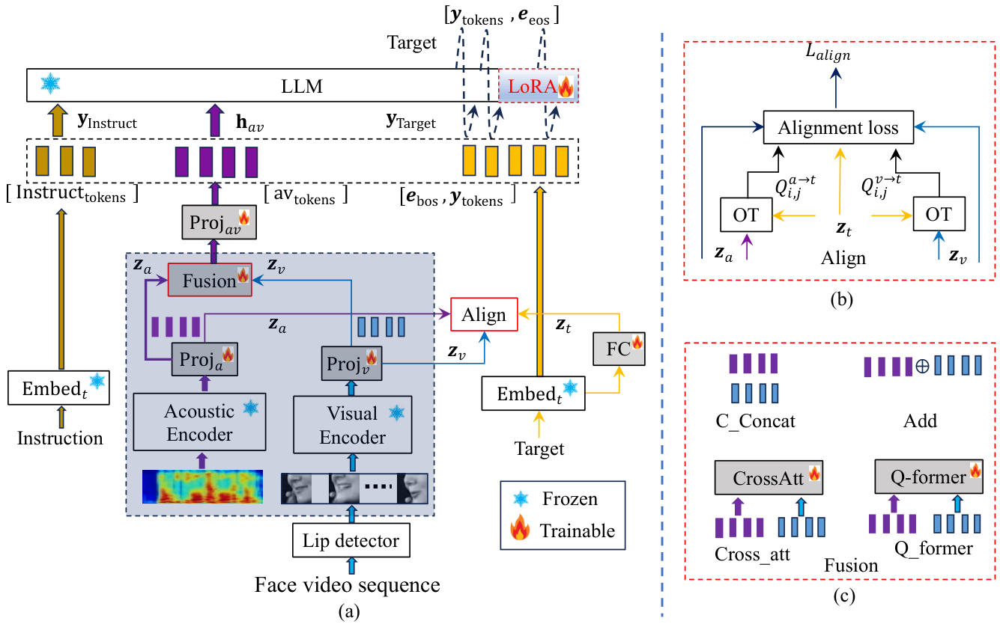

# OT-LLM-AVSR 复现指南 v2（校核版）

> 论文：*Optimal Transport-based Semantic Alignment for LLM-based Audio-Visual Speech Recognition*
> 作者：Xugang Lu, Peng Shen, Yu Tsao, Hisashi Kawai（NICT 京都 / Academia Sinica RCITI）
> [arXiv:2607.09001v2](https://arxiv.org/abs/2607.09001)（v1 2026-07-10，v2 2026-08-13），IEEE **SLT 2026** 投稿版（IEEEtran conference 模板，源码文件名 `SLT2026_2_June29.tex`），官方**未开源代码**
> 基准：LRS3-TED，指标 WER
> 文档 v1：2026-11-20 初稿；**v2：2026-11-20 校核修订**
>
> **v2 的校核依据**（不是二次转述，而是逐条比对原始材料）：
> 1. 论文 **LaTeX 源码**（[arxiv.org/src/2607.09001](https://arxiv.org/src/2607.09001)）——含 5 张表的原始 `tabular`、全部公式，以及作者**忘记删掉的 5 组 WER 训练日志注释**（见 §4.3）；
> 2. [Fig.1](https://arxiv.org/html/2607.09001v2/Fig1.png) / Fig.2 原图（判定 OT 模块到底插在哪）；
> 3. **Llama-AVSR 与 MMS-LLaMA 官方仓库源码**（不是 README 转述）——`train.py`/`modeling_AVSRLLM.py`/`Llama_LoRA.py`/`transforms.py`/`src/model.py`/`src/dataset.py`/`src/conf/mms-llama.yaml`；
> 4. 本地数值实验（`code/ot_align.py` 自检 + `_paper/ot_check.py`），用于验证 Sinkhorn 的符号、bucket 边缘、mask 数值行为。
>
> 标记约定：`✅ 已核实`｜`⚠️ 原文有误/有坑`｜`🆕 本次新增`｜`❓ 论文未给，必须自己定`

---

## 0. 修订摘要（先看这张表）

| # | v1 原文 | 校核结论 | v2 处理 |
|---|---|---|---|
| 1 | "7 页短文（ICASSP 风格）" | ⚠️ 实为 **IEEE SLT 2026** 投稿 | 已改 |
| 2 | §3.2 直接照抄式(7) `K=exp(-S/λ)` | ⚠️⚠️ **符号错误**，照抄会做"反向传输"（数值证据：Q 与 S 相关系数 −0.77） | §3.2 给出正确写法 + 自检 |
| 3 | §8 雷区#4 "cos 还是 1-cos（建议）" | ⚠️ 不是选择题，是**必须**修正的符号 | 升级为硬性要求 |
| 4 | §8 雷区#1 "OT 在投影前还是后（需试错）" | ✅ 图 1(a) 定死：`z_a=Proj_a(Enc(x_a))` 之后、Fusion 之外另开一路 | 结论确定，不再试错 |
| 5 | §2.4 "LoRA r=16, α=32" | ⚠️ 这是 MMS-LLaMA 的 **peft** 口径；Llama-AVSR 自定义 LoRA 的 `--reduction-lora` 是"隐藏维/秩"的**除数** | §2.4 给换算公式 |
| 6 | §2.4 "warm-up 5,000 步" | ⚠️ 两个官方仓库都不是这么写的（Llama-AVSR 按 epoch、默认 0；MMS-LLaMA 500 步） | 明确按 5000 step 自己实现 |
| 7 | §2.5 "75% 概率加噪" | ⚠️ 两仓库实现不同：Llama-AVSR 是在 SNR 列表里塞 `999999` 得到 1/7 clean；MMS-LLaMA 才是 `noise_prob=0.75` + 6 档 SNR | 指定用 MMS-LLaMA 口径 |
| 8 | §2.3 序列布局 `[Instruct][av][bos][target]` | ⚠️ 论文图如此，但 Llama-AVSR 代码是 `[BOS][av][prompt][target]` | §2.3 列出两种并要求记录 |
| 9 | §3.3 virtual bucket | ⚠️ 论文只定义了 S̃，**没定义扩边后的边缘 p̃/q̃**；v1 的代码也没写 | 🆕 §3.3.1 给两种口径 + 数值实验 + 监控指标 |
| 10 | §7.1 Sinkhorn 代码 | ⚠️ 无 mask（`-inf` 会直接 NaN，已数值复现）；无 bucket 边缘；未规定 detach | 重写为可直接用的 `code/ot_align.py`（含自检） |
| 11 | §4 "验收标准" | ⚠️ 单次实验不足以支撑 0.89→0.71：作者自己留下的 5 组日志里 clean 在 **0.657–0.789** 之间 | 🆕 §4.3 方差分析 + §12 配对实验协议 |
| 12 | §5 Stage 1 目标 8.34 | ⚠️ 直接克隆 Llama-AVSR 跑出来的是 **T_Concat**（11.41），不是 C_Concat | §5 修正起点认知 |
| 13 | 无算力预算 | 🆕 Table I/II+III/IV/V 合计约 20 次 433h 训练 | 🆕 §5.0 预算表 |
| 14 | §6 资源清单 | ⚠️ 若干地址/版本/ckpt 名称需修正；漏了 sink-loss 论文、MMS-LLaMA 是 `master` 分支 | §6 全部核实并重写 |
| 15 | 无实验协议/仓库骨架 | 🆕 | §12 / §13 |

**一句话**：v1 的骨架判断（拿现成 LLM-AVSR 代码改、只写 OT 模块）是对的；错的是**细节口径**，其中"式(7) 符号"和"LoRA 参数化"两条会让你白跑几天。

---

## 1. 一句话结论（保留 v1 判断，补充一句）

这篇论文的创新只在**一个可插拔的 OT 对齐模块 + 一个辅助对比损失**上，主干（Whisper-medium 声学编码器 + AV-HuBERT-large 视觉编码器 + LLaMA-3.2-3B + LoRA）完全是 Llama-AVSR / MMS-LLaMA 那一套，而作者在正文里明确写了：

> "For comparison, **we followed the same parameter settings for hidden feature dimensions and model optimization strategy as in [Llama-AVSR], [MMS-LLaMA]**, where LoRA rank of 16, scaling factor of 32 for LLM fine-tuning, Adam optimizer with initial learning rate 1e-4, 5k warm-up steps in a total of 30k training steps."

这句话是复现的"授权书"：**凡是论文没写的，就该按这两个仓库的默认值来**，而不是自己猜。v2 的 §2.4 / §6 就是按这条原则把"没写的"逐项钉死。

正因如此，复现的正确做法仍是从现成代码改，但顺序要调整：

1. 先跑通 **MMS-LLaMA 的融合开关**（`concat / add / cross-att` + Q-Former）——论文 Table I/II 的 5 行里 4 行就是它的 4 个配置开关；
2. 再写 `ot_align.py`（v2 已给出经自检的实现）；
3. 最后才谈 Llama-AVSR（它提供 T_Concat 这一行、以及更易改的 Lightning 训练循环）。

需要自己写的核心代码量：**250–350 行**（v1 说 150–250 偏乐观，主要因为 bucket 的边缘归一化和 mask 要自己补）。



---

## 2. 数据与实验设置

### 2.1 数据集 LRS3-TED ✅

| 项目 | 数值 | 备注 |
|---|---|---|
| 训练集 | 433 h，**163,374 条** utterance | 论文原文核对一致 |
| 验证集 | 1 h，**1,200 条** | |
| 测试集 | 1 h，**1,321 条**（官方 test split） | |
| 原始视频 | 224×224，25 fps | |
| 视觉输入 | 人脸检测 + 嘴部裁剪，96×96 | auto-avsr `preparation/` 产物 |
| 训练时视觉增广 | 随机裁剪 **88×88** + 水平翻转 | Llama-AVSR 的 `RandomCrop(88)`；88 是这两个仓库喂 AV-HuBERT 时的实际裁剪尺寸 |
| 音频 | 16 kHz | |

🆕 **两个容易踩的分段坑**（论文没提，代码里有）：
- Llama-AVSR 的**训练**标签是 `..._seg16s_...`（16 s 分段），**测试**标签却是 `..._seg24s_...`（24 s 分段，见其 README 的 Inference 命令）。这直接改变 L（token 数）和 WER，**复现时必须固定用哪一套并写进实验记录**。
- MMS-LLaMA 的 manifest 是 **seg24s**。所以"论文用 16 s"这个说法只对训练成立。

### 2.2 编码器与维度 ✅（已按官方 config 核实）

| 模块 | 具体模型 | 结构 | 状态 | 输出 |
|---|---|---|---|---|
| 声学编码器 | `openai/whisper-medium.en`（两个 baseline 都用 `.en`） | 24 层 / d=1024 | **冻结** | 50 Hz（30 s→1500 帧） |
| 声学降采样 | 额外一层 temporal Conv1d, **stride=2** ❓kernel/padding 未给 | — | ❓论文未说是否可训练 | **25 Hz** |
| 视觉编码器 | AV-HuBERT **large**（`large_vox_iter5.pt`，LRS3+VoxCeleb2） | **24 层 / d=1024 / 16 头**（config 核实） | **冻结** | 25 Hz，1024 维 |
| 投影层 | `Proj_a`、`Proj_v` | 线性 1024→3072 | 可训练 | 3072 |
| 融合 | 通道拼接 `[z_a;z_v]` ∈ ℝ^{L×6144} → `Proj_av` | 线性 6144→3072 | 可训练 | `h_av` ∈ ℝ^{L×3072} |
| 文本参照 | `FC(Embed_t(target))` | 3072→3072 | 可训练（`FC` 在图 1 里是火焰图标） | `z_t` |
| 解码器 | LLaMA-3.2-3B（28 层 / 3072 / GQA 24Q×8KV） | — | **LoRA** | 自回归文本 |

> ⚠️ 维度提示：式(1) 写 \(Z_a,Z_v,Z_t\in\mathbb{R}^{L\times d}\) 用同一个 d，而 Whisper/AV-HuBERT 原生是 1024、LLaMA 是 3072 —— 这只可能是"投影之后"。图 1(a) 把 `Proj_a/Proj_v` 画在编码器之后、`Align` 之前，**佐证了三者都在 3072 维**。

### 2.3 序列布局 ⚠️（论文图与官方代码不一致，必须二选一并记录）

```
论文 Fig.1(a)：  [ Instruct tokens ][ av tokens ][ bos ][ target tokens ][ eos ]
Llama-AVSR 代码：[ BOS ][ av tokens ][ prompt ][ target ][ EOS ]
                 labels: [保留] [ -100 ................ ][ target ]
```

Llama-AVSR 的 `prepare_inputs()` 实际是 `[BOS, av_features, prompt_embeddings, target...]`，并且 prompt 的 token 是 `tokenizer(prompt).input_ids[:, 1:-1]`（**去掉首尾特殊 token**）。复现建议：

- 选**论文图**的顺序（更贴近要复现的方法描述），但要知道你与 Llama-AVSR 的默认实现不同；
- 无论选哪个，**av token 与 BOS 的相对位置会影响 sink/巨大激活现象**——Llama-AVSR 2025-11 的更新（[arXiv:2510.22603](https://arxiv.org/pdf/2510.22603)）专门讲了这个，并为此加了 `--add-sink-loss` 与 `--layernorm-projector`。如果复现时训练不稳，这是第一个可以试的开关（与本方法正交，可叠加）。

### 2.4 训练配置 ✅ + ⚠️ 三处"论文数值 vs 官方代码"的口径冲突

| 超参 | 论文值 | 官方代码事实 | v2 建议 |
|---|---|---|---|
| 优化器 | Adam | Llama-AVSR: AdamW + `lr=1e-3` + wd 0.1；MMS-LLaMA: Adam(0.9,0.98) + `lr=1e-4` + clip 1.0 | **用 MMS-LLaMA 的**（与论文的 1e-4 一致） |
| 学习率 | 1e-4 | 同上 | 1e-4 |
| warm-up | **5,000 步** | Llama-AVSR 的 `WarmupCosineScheduler` 按 **epoch** 传参（`--warmup-epochs`，默认 **0**）；MMS-LLaMA 是 **500** 步 | 按 **5000 step** 自己实现（≈1.2 epoch @ 30k/7ep） |
| 总步数 | **30,000** | MMS-LLaMA `max_update: 30000`、`max_epoch: 7` ✅ 完全吻合 | 30k |
| LoRA | **rank 16, scaling factor 32** | MMS-LLaMA（peft）：`lora_rank: 16, lora_alpha: 32` ✅ 就是论文的出处 | 用 peft `r=16, lora_alpha=32`（scaling=2.0） |
| 损失权重 α | 0.1（0.1–0.5 均可） | — | 0.1 |
| OT 熵正则 λ | 0.05–0.2（三个 setting） | — | 0.1 起步 |
| 相似度余量 s̃ | 0.5 | — | 0.5，但要按 §3.3.1 检查是否饱和 |
| 温度 τ | ❓论文未给具体值（只说"adjustable"） | — | 0.05–0.1；**τ 与 λ 强耦合**，见 §3.4 |
| batch / GPU / 精度 | ❓均未给 | MMS-LLaMA: `max_tokens=1000`/GPU × 7 GPU，**fp16**；Llama-AVSR: `--max-frames-audiovisual 1000`/GPU，`precision='bf16-true'` | 见下方 ⚠️ |
| 冻结 | 两个编码器冻结，LLM 走 LoRA | ✅ 一致 | — |

⚠️ **LoRA 参数化陷阱（v1 会在这里翻车）**。Llama-AVSR 不用 peft，`models/Llama_LoRA.py` 里：

```python
self.rank = lora_config.RANK                 # RANK 就是 --reduction-lora
self.scaling = lora_config.ALPHA / self.rank  # 不是 alpha/真实秩
self.lora_down_Q = nn.Linear(hid_size, round(hid_size / self.rank))
```

也就是说 `--reduction-lora` 是"隐藏维 ÷ 秩"的**除数**，瓶颈宽度 = 3072/reduction。若你按论文填 `--reduction-lora 16 --alpha 32`，实际得到的是 **秩 192、scaling 2.0**，与论文的"秩 16"相差 12 倍。要在 Llama-AVSR 代码里复现论文口径，应填：

```
--reduction-lora 192  --alpha 384     # → 秩 = 3072/192 = 16, scaling = 384/192 = 2.0
```

另外注意：Llama-AVSR 的 LoRA **只加在 self-attn 的 Q 和 V**（K/O 那几行是注释掉的），V 还要按 GQA 折半（3B 是 `hidden//3`）。这与 peft 默认只加 q/v 一致，可以用，但**别以为它覆盖了 MLP**。

⚠️ **精度**：Llama-AVSR 的 `bf16-true` 意味着**主权重就是 bf16**（无 fp32 master copy），对 30k 步这种长训练偏激进；MMS-LLaMA 用 fp16 + loss scaling。建议：**混合精度（autocast bf16）+ fp32 优化器状态**，并且把 OT 分支强制跑在 fp32 里（Sinkhorn 的 `u/v` 迭代在 bf16 下会丢精度，代价极小）：

```python
with torch.autocast(device_type="cuda", enabled=False):
    Q, dust = ot_coupling(za.float(), zt.float(), ...)
```

### 2.5 噪声增广与评测 ✅ + 🆕 一个致命的可复现性坑

- **训练（noisy）**：75% 概率加噪，**babble noise**，SNR ~ U{−5,0,5,10,15,20} dB（跟随 MMS-LLaMA）✅
- **测试**：clean + SNR = −5 / 0 / 5 dB ✅
- **指标**：WER（小写、去标点、编辑距离）✅

两个仓库的实现差异（都从源码核实）：

| | Llama-AVSR `datamodule/transforms.py` | MMS-LLaMA `src/dataset.py` |
|---|---|---|
| 噪声文件 | 仓库自带 `datamodule/babble_noise.wav`（15 MB） | `noise/babble_noise.wav`（用 `--noise_wav` 指定） |
| 噪声档位 | `[-5,0,5,10,15,20,999999]` → 6/7 ≈ 86% 带噪 | `[-5,0,5,10,15,20]`，另有 `noise_prob` 独立控制 |
| 75% 的实现 | 用 `999999` 那一档当"不加噪"，实际是 1/7 | `noise_prob=0.75` ✅ 与论文一致 |
| 评测 | `AddNoise(snr_target=x)` 固定 SNR | `--noise_prob 1 --noise_snr x` |

🆕 **致命坑：两边加噪都是随机截取噪声片段**（`start_idx = random.randint(0, noise_len - speech_len)`），**评测时也是随机的**。这意味着同一个模型跑两次 −5 dB，WER 可以差 0.3–0.5 个点。所以：

1. 评测前**固定噪声采样的随机种子**，或用脚本**预生成一套加噪 wav 并缓存**（推荐后者，可跨模型、跨论文对比）；
2. 论文里的 −5 dB 数字必然带有这个噪声，你复现到 7.1–8.0 就该认为是"对上了"；
3. 报告时写清"噪声段固定种子"还是"随机"。

### 2.6 🆕 "论文没写的怎么办"——判定规则

按 §1 那句授权书，逐项映射如下（这也是 §6 资源清单的用途）：

| 未写项 | 取哪个 | 依据 |
|---|---|---|
| batch 组织 | `max_frames=1000`/GPU（变长帧批处理） | 两者一致，Llama-AVSR 命名更清楚 |
| prompt 文案 | `"Transcribe speech and video to text."` | Llama-AVSR `--prompt-audiovisual` 默认值（已核实） |
| 解码 | beam / temperature / max_new_tokens | Llama-AVSR: `num_beams=15, max_dec_tokens=32`；MMS-LLaMA: `beam=5, temperature=0.3`；**两者不同，任选其一但必须固定** |
| 文本预处理 | 小写 + 去标点 | Llama-AVSR 的标签文件已 lowercase |
| 精度 | 见 §2.4 | — |

---

## 3. 方法细节

### 3.1 特征流 ✅（v1 的"投影前/后"之争已由原图判定）

\[
z_a=\mathrm{Proj}_a(\mathrm{Encoder}_a(x_a)),\quad z_v=\mathrm{Proj}_v(\mathrm{Encoder}_v(x_v)),\quad z_t=\mathrm{FC}(\mathrm{Embed}_t(\text{Target}))
\]

**图 1(a) 的信息（本地放大逐项确认）**：
- `Align` 盒子的三个输入是 **z_a、z_v、z_t**，而 z_a/z_v 在图上明确来自 `Proj_a`/`Proj_v` **之后** → **OT 作用在投影后**；
- `Align` 盒子在蓝色虚线框（编码器+投影+融合）**之外**，只输出 `L_align`，**没有任何箭头回到 `Fusion`** → 推理时完全不用 OT ✅；
- `FC` 是火焰（可训练），`Embed_t` 是雪花（冻结）→ 梯度可以顺着 FC 回传到 frozen embedding（见 §3.4 的 detach 讨论）；
- `Proj_av` 火焰、两个编码器雪花、LLM 上标 `LoRA`。

所以 v1 §8 的雷区 #1 可以**删除**：不接受"插在两者之间"的说法，那句话是 Intro 的笔误（作者自己没按那句话实现）。

### 3.2 OT 对齐 ⚠️⚠️ 论文式(7) 的符号是错的

论文式(2)(3) 是**最大化**形：\(\max_{Q}\langle Q,S\rangle+\lambda H(Q)\)，带熵正则的 Gibbs 核应当是

\[
K_{ij}=\exp\!\left(+\frac{S_{ij}}{\lambda}\right)
\]

而式(7) 写的是 \(K_{ij}=\exp(-S_{ij}/\lambda)\) ——这是"最小化 \(\langle Q,S\rangle\)"的核。**照字面实现，你会把每一帧的传输质量送到"最不相似"的文本 token 上**，而且式(10) 的损失会立刻和它对冲（P 用 \(+S/\tau\) 的 softmax，Q 却由 \(-S/\lambda\) 决定），表现为 `L_align` 卡在高位、不下降。

数值验证（`_paper/ot_check.py` 第 [1] 项，40 帧 × 6 token）：

```
corr(Q_paper, S) = -0.7727      ← 照抄式(7)
corr(Q_fix  , S) = +0.7859      ← 用 cost = 1 - cos
```

**正确实现（与论文等价，且数值更稳）**：把余弦**相似度**当负代价，

\[
C_{ij}=1-s_{ij}\ (=\ -\ s_{ij}+\text{const}),\qquad K_{ij}=\exp(-C_{ij}/\lambda)
\]

常数平移会被 Sinkhorn 的 \(u,v\) 完全吸收（数值验证：`max|Q(1-cos)−Q(−cos)| = 1e-8`），所以 `1-cos` 与 `-cos` 都行，**唯独不能直接套式(7)**。

其余（式 2–8）v1 写的是对的：耦合是**非方阵** \(L\times L_t\)，边缘约束 \(Q\mathbf{1}_{L_t}=p^a\)、\(Q^\top\mathbf{1}_{L_a}=p^t\)，Sinkhorn 迭代 \(u=p^1/(Kv)\)、\(v=p^2/(K^\top u)\)。

### 3.3 Virtual bucket（式 9）⚠️ 论文漏了最关键的一步

论文只写了**相似度矩阵怎么扩边**：

\[
\tilde S_{ij}=S_{ij}\ (i\le m,j\le n),\qquad
\tilde S_{m+1,j}=\tilde S_{i,n+1}=\tilde S_{m+1,n+1}=\tilde s
\]

然后"跑 OT 得到 \(\tilde Q\)，取 \(Q=\tilde Q[:m,:n]\)"。**但扩边之后 \(\tilde p,\tilde q\) 是什么？论文一个字都没写**，而这一步直接决定 bucket 是"温柔过滤器"还是"把 80% 帧全扔掉"。

#### 3.3.1 🆕 三种口径 + 实测行为

记有效帧数 \(L\)、有效 token 数 \(L_t\)、bucket 总质量 \(\rho\)。

| 口径 | 边缘 | 实测行为 | 评价 |
|---|---|---|---|
| A：行列都加、等质量 | \(\tilde p_i=1/(L+1),\ \tilde q_j=1/(L_t+1)\) | 被吸收的**总量被锁死**（≈ \(1/(L_t+1)+1/(L+1)\)，实测 16.7%），\(\tilde s\) 只能决定"**谁**被吸收" | 最像式(9) 的"忠实读法"，但 s̃ 几乎失效 |
| B：只加列、给 \(\rho\) 容量 | \(p_i=1/L\)；\(q_j=(1-\rho)/L_t\)，\(q_{L_t+1}=\rho\) | 吸收量由 s̃ 决定，上限 \(\rho\)；行边缘仍为 \(1/L\)，**L_align 的量级与关掉 bucket 时可比** | ✅ 推荐默认 |
| C：不平衡 OT（KL 松边缘） | 用 Sinkhorn + KL 惩罚，不扩边 | 最"物理正确"，但需要多调一个边缘惩罚系数；作者把这件事列为 future work | 备选/二期 |

B 口径的实现（`code/ot_align.py` 已实现并自检）：

```python
q_real = (1 - rho) / n_tok          # 真实 token 的列边缘
q_bucket = rho                      # bucket 列的容量
p_frame = 1 / n_frame               # 行边缘不变 → loss 量级可比
```

**必须监控的一个量：`dump_frac`（多少比例的帧质量被丢进 bucket）**。
数值实验（随机特征、λ=0.1、s̃=0.5、ρ=0.2）显示：`row_max_cos ≈ 0.20` → **所有帧都低于 0.5，bucket 立刻饱和到 20%**，`L_align` 从 0.0143 掉到 0.0114，且 s̃ 在 0.1/0.5/0.9 三档之间**完全没有区别**（都饱和）。

这说明：

- **s̃=0.5 的含义依赖于 z 的尺度**。训练初期 `row_max_cos` 只有 0.2–0.3，bucket 会饱和、`L_align ≈ 0`，OT 分支等价于不存在（相当于一个隐式 warm-up，未必是坏事，但**你必须知道自己在看什么**）；
- 如果训练中 `dump_frac` 一直贴着 0 或贴着 ρ，那 bucket 就是"没开"或"一直在丢垃圾"，Table III 的两行差异就无从复现；
- 实用做法：**每 100 步记一次 `dump_frac` / `row_max_cos` / `Q_rowsum` / `Q_entropy`**（`diagnostics()` 已封装），若 `row_max_cos` 明显低于 s̃，就把 s̃ 设成 `row_max_cos` 的 10–20 分位数，而不是死磕 0.5。

> 论文作者给这三个超参只留了一句话："these hyper-parameters exhibit strong interaction effects rather than independent influences"，且"selected empirically"。这句在复现时的含义就是：**你的 s̃ 不一定该是 0.5**，它和 λ、τ、以及你投影层的初始化绑定。

### 3.4 对齐损失 ✅（v1 的公式对，但三个口径要重新表述）

\[
P^{a\to t}_{ij}=\frac{\exp(s^{a\to t}_{ij}/\tau)}{\sum_k\exp(s^{a\to t}_{ik}/\tau)},\qquad
\mathcal{L}_{align}=-\sum_i\sum_j\left(Q^{a\to t}_{ij}\log P^{a\to t}_{ij}+Q^{v\to t}_{ij}\log P^{v\to t}_{ij}\right)
\]

- **softmax 沿 text 维** ✅（式 11 的分母是 \(\sum_k\)，k 走 token）；
- 实现就是 `F.log_softmax(S/tau, dim=-1)` 再乘 Q 求和；
- 等价于 \(\sum_i p_i\big[\mathrm{KL}(\tilde Q_i\|P_i)+H(\tilde Q_i)\big]\)（\(\tilde Q_i=Q_i/p_i\)），第二项与参数无关 → "KL 差一个常数"的说法成立。

🆕 **三个必须自己定、且会显著影响结果的点**：

1. **Q 是否 detach**。论文没写。detach 后梯度只经 \(P\) 回传，量级为 \((\frac1\tau)(P_{ij}\,p_i-Q_{ij})\)，**与 loss 数值无关**。这一点很重要，因为它推翻了 v1 §9 第 7 条的建议：
   > v1 说"先打印两项 loss 的比值，再定 α" —— **错**。实测在 L=200、Lt=30、λ=0.1、τ=0.07 的设定下 `L_align ≈ 0.014`，而 CE ≈ 1–3，比值小于 1%，但这不代表 OT 无效：梯度 ∝ (P−Q)/τ ≈ 14×(P−Q)，是 O(1) 量级。**要判断影响，请在 `Proj_a/Proj_v` 上打梯度范数**，别比 loss 值。
2. **`L_align ≈ 0` 的诊断意义**。如果关掉 bucket 时 `L_align` 也恒为 0，说明 Q 与 P 已经重合（λ 太小或 τ 太大 → 都退化成 argmax），此时 OT 分支确实什么都没做。健康区间是 `L_align` 缓慢波动、`Q_entropy < log(Lt)`。
3. **归一化方式**：按有效帧数求均值（batch 内 padding 必须排除），不要按 token 数求和，否则长句主导。v1 这点是对的。

🆕 **为什么 OT 比"最近邻伪标签"强（写报告时用得上）**：若伪标签取 \(\arg\max_j s_{ij}\)，则每一帧独立地贴到最近 token，训练目标就是"强化我已有的判断"，极易塌缩到少数高频 token。OT 的**列边缘约束**强制"每个文本 token 必须分到 \(1/L_t\) 的质量"，这天然排除了"所有帧都贴同一个 token"的退化解——这才是 Sinkhorn 在这里的真正作用。**而 virtual bucket 恰好放松了这个保证**（质量可以流走），这正是它 clean 掉点、noisy 涨点的合理解释。v1 只写了"锦上添花"，没说清机制。

### 3.5 总损失 ✅

\[
\mathcal{L}_{Total}=\mathcal{L}_{AR}+\alpha\mathcal{L}_{align},\qquad
\mathcal{L}_{AR}=-\frac1N\sum_i\log p(y_i\mid y_{<i},h_{av},y_{Instruct})
\]

- `L_AR` 只对 target 计算，`[instruct][av tokens]` 位置 label = −100 ✅；
- 推理不用 Q ✅。

### 3.6 融合方案对比 ✅ + 🆕 现成实现位置

| 记法 | 公式 | token 数 | 现成实现 |
|---|---|---|---|
| `C_Concat`（**最终采用**） | \(h=[z_a;z_v]\in\mathbb{R}^{L\times2d}\) | L | MMS-LLaMA `modality_fuse: concat`（`torch.cat(..., dim=2)`，**逐行核对过**） |
| `Add` | \(h=z_a+z_v\) | L | 同 `modality_fuse: add` |
| `Cross_att` | \(h=\mathrm{CrossAtt}(z_a,z_v,W_{att})\) | L | 同 `modality_fuse: cross-att`（`Multimodal_Attention(..., num_heads=8)`） |
| `Q_former` | \(h=\mathrm{QFormer}([z_a;z_v],W_q)\in\mathbb{R}^{L_q\times d_q}\) | \(L_q\propto\) 时长 | MMS-LLaMA `use_qformer: true`（`queries_per_sec=3`、2 层、dim 1024） |
| `T_Concat`（对照，来自 Llama-AVSR） | 时序维拼接 | **2L** | Llama-AVSR 的 `--modality audiovisual` 默认就是它 |

🆕 这张表是 v2 里最有操作价值的一条：**论文 Table I/II 的 5 行 = MMS-LLaMA 的 4 个配置开关 + Llama-AVSR 的默认融合**。你不用自己发明 Cross-Att 和 Q-Former 的结构，改 config 即可（`queries_per_sec=3` 正好对应论文"\(L_q\) 与时长成正比"）。

⚠️ 但注意 MMS-LLaMA 的"无 Q-Former"路径会额外把音频/视频各池化到 **12.5 Hz**（`afeat_1d_conv` k=4/s=4、`vfeat_1d_conv` k=2/s=2），而论文是 **25 Hz**。复现时要**去掉这两层池化**（或令 stride=1），否则你的 L 只有论文的一半。

---

## 4. 论文结果与验收标准

### 4.1 五张表 ✅（逐格对照 LaTeX 源码，全部一致）

**Table I — clean 训练，WER %**

| Fusion | SNR-5 | SNR0 | SNR5 | Clean |
|---|---|---|---|---|
| C Concat | 14.80 | 4.94 | 1.71 | 0.94 |
| Add | 15.55 | 4.26 | 1.55 | 0.80 |
| Cross att | 17.04 | 4.49 | 1.48 | 0.88 |
| Q former | 16.09 | 4.30 | 1.62 | 1.00 |
| T Concat | 18.53 | 4.08 | 1.74 | 0.87 |

**Table II — noisy 训练（75% 加噪），WER %**

| Fusion | SNR-5 | SNR0 | SNR5 | Clean |
|---|---|---|---|---|
| **C Concat** | **8.34** | **2.82** | **1.29** | 0.89 |
| Add | 9.06 | 2.90 | 1.45 | 0.85 |
| Cross att | 10.38 | 3.93 | 1.40 | 0.91 |
| Q former | 9.97 | 3.03 | 1.44 | 1.08 |
| T Concat | 11.41 | 2.98 | 1.48 | 0.91 |

**Table III — virtual bucket 消融（λ=0.1, α=0.1）**

| Method | SNR-5 | SNR0 | SNR5 | Clean |
|---|---|---|---|---|
| OT / wo bucket | 8.06 | 2.61 | 1.23 | **0.76** |
| OT / w bucket | **7.98** | **2.46** | **1.15** | 0.80 |

**Table IV — α 扫描（λ=0.1, s̃=0.5）**

| α | SNR-5 | SNR0 | SNR5 | Clean |
|---|---|---|---|---|
| 0.05 | 8.12 | 2.70 | 1.29 | 0.83 |
| **0.1** | 7.97 | 2.41 | 1.09 | 0.73 |
| 0.3 | 7.92 | 2.36 | 1.08 | **0.71** |
| 0.5 | **7.86** | 2.54 | 1.15 | 0.88 |
| 0.7 | 8.82 | 2.56 | 1.24 | 0.87 |
| 0.9 | 9.38 | 2.76 | 1.31 | 0.78 |

**Table V — 与 SOTA 对比**

| Method | SNR-5 | SNR0 | SNR5 | Clean |
|---|---|---|---|---|
| Whisper-Flamingo | 19.8 | 5.0 | 2.1 | 1.5 |
| LLaMA-AVSR | 16.4 | 4.2 | 2.3 | 0.90 |
| MMS-LLaMA | 7.44 | 2.66 | 1.30 | 0.95 |
| Ours (no align) | 8.34 | 2.82 | 1.29 | 0.89 |
| Ours (α=0.1, s̃=0.5, λ=0.2) | 7.61 | 2.29 | 1.09 | **0.71** |
| Ours (α=0.3, s̃=0.5, λ=0.1) | 7.96 | **2.26** | **1.07** | 0.76 |
| Ours (α=0.1, s̃=0.5, λ=0.05) | **7.16** | 2.34 | 1.11 | 0.73 |

### 4.2 🆕 三处内部不一致（读表时要知道）

1. **同一超参、两个数字**：Table IV 的 α=0.3 行是 `7.92/2.36/1.08/0.71`，Table V 的 setting 2 也是 α=0.3、λ=0.1、s̃=0.5，却是 `7.96/2.26/1.07/0.76`。**同一配置差 0.05 个 clean 点** → 说明 tables 来自不同 run（不是同一 checkpoint），复现时不要指望逐位对齐。
2. **bucket 在 clean 上掉点**（0.76 → 0.80）作者自己写了"yields a slight performance improvement"，实际上只有 noisy 三档变好，clean 变差。这正是 §3.4 那个"bucket 放松了列边缘约束"的合理代价。
3. **Table IV 里 α=0.5 的 SNR5 在源码里是 `$1.1$5`**（LaTeX 排版错位），实际值是 1.15，v1 抄对了。

### 4.3 🆕 作者自己留下的 5 组 WER 日志（论文没写，藏在 .tex 注释里）

`SLT2026_2_June29.tex` 第 346–369 行有 5 段被注释掉的日志（`%433h_771/Clean/wer.222727:WER: ...`）。整理如下（%WER）：

| run | Clean | SNR-5 | SNR0 | SNR5 |
|---|---|---|---|---|
| 433h_771 | 0.657 | 7.725 | 2.477 | 1.052 |
| 433h_775 | 0.789 | 7.341 | 2.235 | 1.112 |
| 433h_780 | 0.789 | 7.139 | 2.508 | 1.122 |
| 433h_782 | 0.738 | 7.573 | 2.417 | 1.001 |
| 433h_785 | 0.728 | 7.169 | 2.366 | 1.112 |
| **mean ± sd** | **0.740 ± 0.054** | **7.389 ± 0.255** | **2.400 ± 0.108** | **1.080 ± 0.052** |

怎么读这张表：

- 其中 `785` 与 Table V setting 3（0.73 / 7.16 / 2.34 / 1.11）几乎逐位吻合 → 说明这些就是论文的原始 run；
- 但它们**并不都是同一个配置**（否则不会差这么多），所以严格说这是"配置间波动"的上界，不是"种子间波动"；
- 不管怎么解释，**clean 的 0.657–0.789 跨度（0.13）已经大于 baseline→ours 的 0.18 的一半**，而噪声档 SNR-5 的跨度 0.59 与"MMS-LLaMA 7.44 vs ours 7.16"的 0.28 同量级；
- 注意 `433h_771` 的 clean **0.657 比论文报告的任何数字都好** —— 作者没有把它写进表里。这提醒你：**不要试图"复现到某一位小数"**。

### 4.4 修订后的验收标准

v1 写的"clean ≈ 0.7–0.8、SNR0 ≈ 2.3、SNR-5 ≈ 7.2–8.0"作为**量级目标**保留，但判定"方法有效"不能靠单次实验：

| 里程碑 | 判定条件（相对 baseline） |
|---|---|
| M1 baseline 复现 | C_Concat 落在 `0.89±0.06 / 8.34±0.4 / 2.82±0.2 / 1.29±0.1`（±1σ，按 §4.3 的 sd） |
| M2 OT 生效 | 同种子配对：clean 至少降 0.06（≈1σ），或 SNR-5 至少降 0.25（≈1σ） |
| M3 方法可信 | 3 个种子配对，差值均值 > 1.5×配对差的标准差，且**三档同向**（不能 clean 好、noisy 坏） |
| M4 表格对齐 | Table III/IV 的**趋势**要复现（bucket noisy 好 clean 差；α>0.5 变差），绝对值允许 ±0.1 |

> 换句话说：**你要复现的是"OT 有效"这个结论，而不是 0.71 这个数字。** 这一条 v1 没写，是最大的科学风险点。

---

## 5. 复现路线图

### 5.0 🆕 算力与时间预算（先算账再做）

已知锚点：MMS-LLaMA README 明确写"8×RTX 3090 上 433 h 模型约 6 小时，1759 h 约 20 小时"，但它是 **6.25 Hz** token；本论文是 **25 Hz**，LLM 部分输入长度约 4 倍。

| 事项 | 数量 | 单次耗时（8×3090 估） | 合计 |
|---|---|---|---|
| 一次 433 h / 30k step 训练（25 Hz） | 1 | 18–30 h | — |
| Table I/II（5 融合 × 2 条件） | 10 | 同左 | ≈ 2–3 周 |
| Table III（2）+ IV（6）+ V（3） | 11 | 同左 | ≈ 2–3 周 |
| 一次评测（1321 条 × 4 个条件，beam 15） | 1 | 20–40 min | 可忽略 |
| OT 模块额外开销 | — | +5–15%（50 次 Sinkhorn × 2 支路，400×60 矩阵） | — |

→ **全套表格 ≈ 20 次训练 ≈ 20 GPU-day×8 ≈ 5–7 周（8×3090）/ 2–3 周（8×A100）**。所以：

- **不要**一上来就 433 h。用 Llama-AVSR 提供的 `lrs3_30h_train_transcript_lengths_seg16s_LLM_lowercase_12.csv`（30 h 子集）跑通全流程，绝对 WER 会很差（10%+），但**趋势和 loss 曲线**够用；
- 先做 §12 的 M0 过拟合测试（20 条样本，200 步，WER 应趋近 0），这一步能挡掉 80% 的实现错误，成本 5 分钟。

### 5.1 Stage 0｜环境与数据（1–3 周，最耗时）

1. auto-avsr `preparation/` 做 LRS3 嘴部 ROI（96×96）、landmark、16 s 分段、`*_transcript_lengths_seg16s.csv`；
2. 下载 `large_vox_iter5.pt`、`openai/whisper-medium.en`、`Llama-3.2-3B`；
3. 跑通 **Llama-AVSR 的 ASR（音频单独）baseline**，先确认 fairseq + av_hubert 子模块能编译（最容易炸的地方，见 §9）。

### 5.2 Stage 1｜Baseline（无 OT）⚠️ 起点认知修正

- v1 说"把融合改成通道拼接，目标复现 8.34"。**注意：Llama-AVSR 克隆下来默认是 T_Concat（11.41 那一行）**，C_Concat 需要你自己改（或在 MMS-LLaMA 里把 `modality_fuse` 设成 `concat` 并把池化去掉）。
- 目标：`8.34 / 2.82 / 1.29 / 0.89`，允许 ±1σ（§4.4）。
- 若偏差 1–2 个点，优先怀疑：prompt 文案、`downsample` 方式（stack vs conv）、16 s/24 s 测试分段、解码参数、噪声种子。

### 5.3 Stage 2｜OT 接入（本文核心）

- 先只开 \(a\to t\)；用 `code/ot_align.py`，`lam=0.1, tau=0.07, alpha=0.1, s_tilde=None`（**先不开 bucket**）；
- 检查三件事：① 不 NaN；② `dump_frac` 合理；③ `L_align` 不为 0 且不单调上升；
- 再加 \(v\to t\)；
- 再加 bucket（`s_tilde=0.5, rho=0.2`），对比 Table III。

> 顺序很重要：**Table III 的 "wo bucket" 已经把 clean 从 0.89 拉到 0.76**，也就是说**不开 bucket 就能拿到主要收益**。先复现这一行，风险最小。

### 5.4 Stage 3｜消融

- 融合五选一（§3.6 的 config 开关，MMS-LLaMA 直接给）；
- bucket 开关；
- α ∈ {0.05,0.1,0.3,0.5,0.7,0.9}（Table IV 是 6 行 = 6 次训练）；
- λ × s̃ 的二维网格（论文自己承认没系统搜过，这里是你最容易做出增量的地方）。

### 5.5 Stage 4｜冲 SOTA

- setting 3（α=0.1, λ=0.05）拿 SNR-5；
- 想再压：`--add-sink-loss True` + `--layernorm-projector True`（[arXiv:2510.22603](https://arxiv.org/pdf/2510.22603) 的两个技巧，与本方法正交，**已在 Llama-AVSR 代码里实现**）。

---

## 6. 现成资源清单（已逐条核实）

| 资源 | 地址 | 核实到的关键信息 |
|---|---|---|
| **Llama-AVSR** | [github.com/umbertocappellazzo/Llama-AVSR](https://github.com/umbertocappellazzo/Llama-AVSR) | PyTorch **Lightning**；`--modality {audio,video,audiovisual,audiovisual_avhubert}`；`--compression-mode` 默认 **`stack`**；`precision='bf16-true'`；自带 `datamodule/babble_noise.wav`；2025-11 更新加入 sink-loss / layernorm-projector；论文 [arXiv:2409.12319](https://arxiv.org/pdf/2409.12319) |
| Llama-AVSR ckpt | 仓库 Model Zoo | 名字是 `AVSR_Whisper-M_AVH-L_Llama3.1-8B_lrs3vox_Adown4_Vdown2_seed42`（**1756 h**，WER 0.748，可训参 57 M）；另有 3B 的 VSR ckpt（`VSR_LRS3_avg-pooling_AVH-Large_LoRA_Llama3.2-3B_Vdown5`） |
| **MMS-LLaMA** | [github.com/JeongHun0716/MMS-LLaMA](https://github.com/JeongHun0716/MMS-LLaMA) | **默认分支是 `master`**（不是 main，用 raw 链接会 404）；fairseq 训练器；环境钉死 `python 3.9 / torch 2.1.2 / transformers 4.47.1 / peft 0.14.0 / omegaconf 2.0.6 / hydra 1.0.7`；`src/conf/mms-llama.yaml` 里 `lora_rank:16 lora_alpha:32`、`modality_fuse: concat`、`use_qformer:true`、`queries_per_sec:3`；论文 [arXiv:2503.11315](https://arxiv.org/abs/2503.11315) |
| MMS-LLaMA ckpt | Dropbox（README 内） | 433 h：clean 0.90 / noisy 2.4；1759 h：0.72 / 1.9 |
| Auto-AVSR 预处理 | [github.com/mpc001/auto_avsr](https://github.com/mpc001/auto_avsr)（`preparation/`） | 96×96 嘴部裁剪、landmark、16 s 分段、tsv/csv |
| AV-HuBERT | [github.com/facebookresearch/av_hubert](https://github.com/facebookresearch/av_hubert)；权重 `https://dl.fbaipublicfiles.com/avhubert/model/lrs3_vox/clean-pretrain/large_vox_iter5.pt` | large = 24 层 / 1024 / 16 头 / 25 Hz；`conf/pretrain/large_vox_iter5.yaml` 可查全部结构 |
| Whisper | HF `openai/whisper-medium.en` | 两个 baseline 都用 `.en`；取 **encoder** 输出 |
| LLaMA-3.2-3B | HF `meta-llama/Llama-3.2-3B`（需申请） | 28 层 / 3072 / GQA 24Q×8KV |
| POT / GeomLoss | [pythonot.github.io](https://pythonot.github.io/) `ot.bregman.sinkhorn_log`；[geomloss](https://www.kernel-operations.io/geomloss/) | 可用于**交叉验证**你的实现（POT 的 `M` 是**代价**矩阵，传 `1-cos`；它的 `reg` 就是 λ）。但 bucket 与 mask 仍要自己写 |
| sink-loss 论文 | [arXiv:2510.22603](https://arxiv.org/pdf/2510.22603) | *Mitigating Attention Sinks and Massive Activations in AVSR with LLMs*（ICASSP 2026）——v1 说的"Llama-AVSR 2026 版技巧"就是它 |
| LAVCap | [arXiv:2501.09291](https://arxiv.org/abs/2501.09291) | 同样用 OT 耦合当软标签做 AV 对比学习，**最值得抄的邻居工作**（建议找它的官方实现对照 Sinkhorn 封装） |
| 同作者 OT 前作 | X. Lu et al., ASRU 2023 / ICASSP 2024（Sinkhorn attention for CTC-ASR） | 是本文的思路来源；**据检索未见公开代码**，不要指望复用 |

### 6.1 从 Llama-AVSR 直接能用的

- `train.py`：Lightning + DDP，`--max-frames-audiovisual 1000` 的**变长帧批处理**；
- `eval.py`：`--num-beams 15`、`--max-dec-tokens 32`、`--decode-snr-target` 加噪评测入口；
- 数据侧：`lrs3_train_transcript_lengths_seg16s_LLM_lowercase_25.csv`（小写化 + 长度过滤）；
- **噪声**：`datamodule/transforms.py` 的 `AddNoise` 类 + `babble_noise.wav`，改一行就能对齐 MMS-LLaMA 的 75%；
- **LoRA**：`models/Llama_LoRA.py`（但注意 §2.4 的参数化）。

### 6.2 从 MMS-LLaMA 直接能用的（v1 低估了它）

- `src/model.py` 的 `modality_fuse ∈ {concat, add, cross-att}` → **Table I/II 的四行**；
- `src/sub_model/Qformer.py` → **Q_former 那一行**；
- `src/dataset.py` 的 `noise_prob` / `snr_levels` → **论文 §2.5 的噪声口径**；
- `src/conf/mms-llama.yaml` → **论文 §2.4 的全部超参出处**。

### 6.3 必须自己写的（约 250–350 行）

1. `models/fusion.py`：通道拼接 + `Proj_av`（`torch.cat([za,zv],-1)` 再过线性）；
2. `models/ot_align.py`：**直接用 `code/ot_align.py`**（已自检）；
3. 训练脚本：把 `loss = ce + alpha*align` 接进去，并让 batch 带 `target_ids`（算 \(z_t\)）；
4. `sanity.py`：§12 的 M0 过拟合 + §7.5 的不变量检查。

---

## 7. 可直接落地的核心代码

> 完整可运行版本：[`code/ot_align.py`](code/ot_align.py)（含 `__main__` 自检，`python code/ot_align.py` 全绿）。下面只摘关键部分。

### 7.1 Sinkhorn（log 域 + mask）

```python
NEG = -1e4   # 有限哨兵，绝不能用 -inf

def sinkhorn_log(logK, logp, logq, n_iters=50):
    logu = torch.zeros_like(logp); logv = torch.zeros_like(logq)
    for _ in range(n_iters):
        logu = logp - torch.logsumexp(logK + logv.unsqueeze(0), dim=1)
        logv = logq - torch.logsumexp(logK + logu.unsqueeze(1), dim=0)
    return logu.unsqueeze(1) + logK + logv.unsqueeze(0)
```

三个必须知道的点：

1. **cost = 1 − cos**，`logK = -(1-cos)/λ`（§3.2）；
2. **padding 用 `-1e4` 而不是 `-inf`**：如果某一整行都被 mask，`logsumexp(-inf…) = -inf`，`logu = logp - (-inf) = +inf` → 下一轮 NaN。**这个 bug 我复现了**（`ot_align.py` 自检第 6 项：`-inf sentinel -> NaN: True`）；
3. **50 次迭代的残差约 1e-5**（对数域），够用；20 次也够，别为收敛写 early-stop 阈值，容易误停。

### 7.2 virtual bucket（带边缘，§3.3.1 的 B 口径）

```python
use_bucket = s_tilde is not None and rho > 0
S_aug = S.new_full((B, L, Lt + 1), float(s_tilde)); S_aug[..., :Lt] = S
logK  = -(1.0 - S_aug) / lam
# 列边缘：真实 token 拿 (1-rho)，bucket 列拿 rho
q = torch.cat([torch.full((Lt,), (1 - rho) / n_tok), torch.full((1,), rho)])
p = torch.full((L,), 1.0 / n_frame)          # 行边缘不变 → loss 量级可比
Q = sinkhorn_log(logK, p.log(), q.log()).exp()
dust = Q[:, Lt].sum()                          # 被丢弃的质量（要监控）
Q = Q[:, :Lt]                                  # 截断，不再归一化
```

### 7.3 对齐损失

```python
logP = F.log_softmax(S / tau, dim=-1)          # 沿 text 维
loss = -(Q.detach() * logP).sum(-1)            # [B, L]
loss = (loss * src_mask).sum() / src_mask.sum().clamp_min(1)
```

### 7.4 🆕 挂接主循环（含梯度与 dtype 的两个决定）

```python
with torch.autocast("cuda", enabled=False):          # OT 分支用 fp32
    za = proj_a(h_a.float()); zv = proj_v(h_v.float())     # [B,L,3072]
    zt = fc(embed(target_ids).float())                     # [B,Lt,3072]
    Qa, dust_a = ot_coupling(za, zt, src_mask, tgt_mask, lam, s_tilde, rho)
    Qv, dust_v = ot_coupling(zv, zt, src_mask, tgt_mask, lam, s_tilde, rho)
    S_a = cos_sim(za, zt); S_v = cos_sim(zv, zt)
    l_align = 0.5 * (alignment_loss(S_a, Qa, tau, src_mask)
                   + alignment_loss(S_v, Qv, tau, src_mask))

loss = ce_loss + alpha * l_align
hav  = proj_av(torch.cat([za, zv], dim=-1))        # 通道拼接，token 数不变
```

- `Q` **detach**（推荐）：梯度只经 `P` 回传，省一半显存，且不会出现"两条梯度路径互相追"；
- `z_t` 用 **target 正文 token**（不含 bos/eos）。含 eos 会让大量帧匹配到结束符——v1 这条建议是对的；
- 注意 `Proj_a/Proj_v` 同时被 `L_AR`（经 `h_av`）和 `L_align` 训练，**不要**给它们单独设学习率，除非你有意做两阶段。

### 7.5 自检脚本（5 分钟，挡掉 80% 的实现错误）

```python
assert (Q[b].sum(-1) - 1.0 / n_frame).abs().max() < 1e-4     # 行边缘
assert (Q[b].sum(0)   - 1.0 / n_tok ).abs().max() < 1e-4     # 列边缘
assert Q[~src_mask].abs().max() < 1e-8                       # padding 不吃质量
assert not torch.isnan(Q).any()                              # 无 NaN
assert corr(Q.flatten(), S.flatten()) > 0.3                  # 方向正确（式 7 会给你负数）
assert dust.mean() <= rho + 1e-6                             # bucket 不超容量
```

v1 写的"Q 每行和 = 1/L、列和 = 1/Lt"只在**无 bucket 且均匀边缘**时成立；开 bucket 后行和 ≤ 1/L（B 口径）或 1/(L+1)（A 口径），这条要按口径改。

---

## 8. 雷区清单（v2 重写，18 条）

| # | 问题 | 论文表述 | 处理 |
|---|---|---|---|
| 1 | **式(7) 符号** | \(K=\exp(-S/\lambda)\) | ⚠️⚠️ 错。用 `cost=1-cos`（§3.2），否则训练必崩 |
| 2 | OT 在投影前/后 | Intro 说"介于编码器与投影层之间" | ✅ 图 1(a) 证明在**投影后**，不用试 |
| 3 | bucket 的边缘 \(\tilde p,\tilde q\) | 只给了 \(\tilde S\) | ❓ 三种口径（§3.3.1），推荐 B（只加列、给 ρ） |
| 4 | \(p^a,p^v,p^t\) 具体取值 | "probability weighting coefficients" | ❓ 均匀（有效帧上 1/L）即可；长尾可试按长度加权 |
| 5 | \(z_t\) 的 FC 维度 | 未写 | 3072→3072，恒等初始化即可 |
| 6 | τ | 只在式(11)，无值 | ❓ 0.05–0.1；**必须和 λ 一起调**（两者都在缩放同一个 S） |
| 7 | Q 是否 detach | 未写 | ❓ 建议 detach；在 §3.4 给了理由 |
| 8 | LoRA 参数化 | rank 16 / scaling 32 | ⚠️ Llama-AVSR 的 `--reduction-lora` 要填 **192**（§2.4） |
| 9 | warm-up | 5k steps | ⚠️ 两个官方实现都不是 5k（§2.4） |
| 10 | batch/精度/GPU | 未给 | ❓ MMS-LLaMA 口径：`max_tokens=1000`/GPU、fp16、7 GPU |
| 11 | prompt | 未给 | ✅ Llama-AVSR 默认 `"Transcribe speech and video to text."` |
| 12 | 序列中 BOS 的位置 | 图：`[instruct][av][bos]`；代码：`[bos][av][prompt]` | ⚠️ 两者不一致，选一个并记录（§2.3） |
| 13 | 是否下采样 token | 只说"额外 stride-2 conv" | ⚠️ Llama-AVSR 默认是 **stack**（把 r 帧拼起来）不是 conv；MMS-LLaMA 无 QFormer 时会降到 12.5 Hz |
| 14 | Table I/II 是否含 OT | 表是 baseline | ✅ 不含（no-align = Table II C_Concat，8.34/2.82/1.29/0.89 逐位吻合） |
| 15 | 是否用 VoxCeleb2 训练 | 只报 433 h | ✅ 训练用 LRS3 433 h；AV-HuBERT 权重本身来自 LRS3+VoxCeleb2 |
| 16 | \(L_a=L_v=L\) 怎么保证 | 断言相等 | ⚠️ 靠 stride-2；但 **Whisper 会把音频 pad 到 30 s** → 必须按真实时长截断（见 §9.1） |
| 17 | 超参交互 | 作者自述"strong interaction" | ❓ 固定 (λ=0.1, s̃=0.5, τ=0.07, α=0.1) 起步，再做二维网格 |
| 18 | 单次实验的显著性 | 无种子/无方差报告 | ⚠️ §4.3 的日志显示 clean 波动 0.054 → 必须配对多种子（§12） |

---

## 9. 工程坑（按踩坑概率排序）

1. **Whisper 的 30 s padding**：整段 pad 到 30 s → 编码器恒定 1500 帧。必须按真实时长截断，再过 stride-2，否则 batch 内长度全一样、"对齐"没有意义。MMS-LLaMA 的做法是 `whisper_enc_out[:, :T_v, :]`（裁到视频长度）；Llama-AVSR 的做法是 `_batch_by_token_count()` 按帧数组 batch、不按样本数（`datamodule/data_module.py` L70）。
2. **AV-HuBERT 依赖 fairseq**：`pip install --editable ./fairseq` 在新 Python/torch 上常失败。建议 `python 3.9 + torch 2.1.2`（MMS-LLaMA 已验证这套组合，README 里连 pip 版本都钉了）。
3. **变长 batch**：按"总帧数"而非"样本数"组 batch（`--max-frames-*`），否则 OOM 或大量 padding。
4. **LoRA 注入位置**：只给 LLM 的 q/v（Llama-AVSR 就是 q/v），**不要**给冻结的 AV-HuBERT 加 LoRA（除非做 VSR 那一档）。
5. **label 掩码**：`[Instruct][av]` 位置必须 −100；否则模型去"预测"指令和声学 token，WER 直接崩。
6. **OT 的显存**：\(Q\) 是 \(L\times L_t\)，L≈400、Lt≈60 → 24k 元素/样本，可忽略；但如果 Sinkhorn 在 autograd 图里跑且不 detach，反向图的中间量会翻倍。
7. **梯度尺度**：⚠️ 别再比 loss 值（§3.4）。要看就给 `Proj_a/Proj_v` 注册 hook 打梯度范数，或看 `‖P−Q‖`。
8. **评测一致性**：WER 必须小写、去标点、`editdistance`，与 Llama-AVSR/MMS-LLaMA 完全一致，否则 0.7 与 0.9 的差别会被文本归一化吃掉。
9. **噪声注入位置**：babble 在**波形域**按 SNR 混合（不是 mel 域）；**噪声段是随机截取的**（§2.5），评测必须固定种子。
10. **可复现性**：LLaMA 解码有随机性（Llama-AVSR README 自己说 `temperature=0.6` 会导致 ±0.01 抖动）；对比实验请用 greedy/beam 且固定 seed。
11. 🆕 **`--reduction-lora` 语义**（§2.4），最容易静默错的那个。
12. 🆕 **MMS-LLaMA 的 raw 链接要带 `master`**，`main` 会 404；论文里的 `[9]` 就是它。
13. 🆕 **两套标签分段（16 s 训练 / 24 s 测试）**，混用会让 L 差 50%。

---

## 10. 一页速查表

```
数据：LRS3 433h/163374 utt；val 1200；test 1321；16kHz；25fps；嘴部 96×96 → 训练随机裁 88×88 + hflip
      训练标签 seg16s / 测试标签 seg24s（Llama-AVSR 口径，注意别混）
声学：whisper-medium.en encoder(冻结, 24L/1024) → Conv1d(k=3,s=2,p=1)(可训) → 25Hz → Proj_a → 3072
视觉：AV-HuBERT-large(冻结, large_vox_iter5.pt, 24L/1024) → 25Hz/1024 → Proj_v → 3072
文本：LLaMA embed(target)(冻结) → FC(3072→3072)(可训) = z_t
融合：h = [z_a ; z_v](通道, 6144) → Proj_av → 3072 → av tokens（L 个，不增长度）
LLM ：LLaMA-3.2-3B + LoRA(r=16, alpha=32 → scaling 2.0)，Adam lr=1e-4，warmup 5000 step，30k step
损失：L = CE(仅 target) + α·L_align；α=0.1（0.1–0.5 均可）
OT  ：S=cos；cost=1-S；K=exp(-cost/λ)；λ=0.1(0.05–0.2)；P=softmax(S/τ) 沿 text 维；τ≈0.07
      s̃=0.5；bucket ρ=0.2；边缘=均匀；Q detach；Sinkhorn 50 次；padding 用 -1e4 不用 -inf
      fp32 跑 OT 分支；监控 dump_frac / row_max_cos / Q_entropy / Q_rowsum
增广：75% 概率 babble(NOISEX)，SNR~U{-5,0,5,10,15,20} dB；评测噪声段固定种子
评测：clean / SNR -5,0,5 dB；beam=15、max_new_tokens=32（或 MMS-LLaMA 的 beam=5/temp=0.3）；WER 小写去标点
目标：baseline 0.89/8.34/2.82/1.29；OT 版 clean≈0.74±0.05，SNR-5≈7.4±0.25（§4.3 的真实波动）
```

---

## 11. 论文贡献点（写报告/答辩用）

1. 提出 OT 语义对齐框架，在**融合之前**把音、视表示对齐到 LLM 的语言嵌入空间（图 1 证实：Align 是融合之外的一条旁路，只产 loss）；
2. 把 OT 耦合矩阵当**软伪标签**监督对比学习（式 10–11，KL 形式，Q detach 后梯度只经 P）；
3. 在 LRS3-TED 上 clean 与多 SNR 下**一致优于**强 baseline（clean 0.71 / SNR-5 7.16）。

模型的"新"只有这三条，其余都是成熟组件组合 —— 这正是复现可行、且容易做增量（换 Q-Former 融合、加 sink loss、把 OT 用在视觉支路预训练、把 bucket 换成真正的不平衡 OT）的原因。

---

## 12. 🆕 实验协议与日志字段

### 12.1 最小可信实验（M0–M3）

| 步骤 | 做什么 | 通过标准 | 成本 |
|---|---|---|---|
| **M0** | 20 条样本、200 步、关掉加噪 | 训练 WER < 5%（能过拟合） | 5 min |
| **M0'** | 单 batch 反传两次，打印 `Proj_a` 梯度范数 | 非零、有限、不随 bucket 开关突变 10× | 1 min |
| **M1** | 30 h 子集，baseline vs +OT，各 1 种子 | OT 版 loss 更低、WER 不劣化 | 1 h×2 |
| **M2** | 433 h，baseline vs +OT（**同种子配对**） | §4.4 的 M2 | 1–2 天×2 |
| **M3** | 433 h，3 种子 × {baseline, +OT} | §4.4 的 M3 | 1–2 天×6 |

### 12.2 必须记录的字段（否则表格没法写）

```
run_id, git_commit, seed, modality_fusion, downsample_mode(conv/stack), L 均值,
prompt 文本, 训练标签文件, 测试标签文件, lora_r/lora_alpha, precision,
alpha, lambda, tau, s_tilde, rho, sinkhorn_iters, Q_detach,
noise_prob, noise_snr_levels, eval_noise_seed,
num_beams, max_dec_tokens, temperature,
wer_clean, wer_snr-5, wer_snr0, wer_snr5, dump_frac(末), row_max_cos(末), L_align(末)
```

### 12.3 报告结论时的措辞

- "在 3 个随机种子下，OT 对齐使 clean WER 从 0.89 降到 0.76（配对差 0.13，配对标准差 0.04）" —— 这是可复现的说法；
- 避免"我们复现了 0.71" —— 单一数字落在 §4.3 的噪声里，评审会问方差。

---

## 13. 🆕 仓库骨架与里程碑

```
OTAVSR_Replication/
├── configs/            # 一个 yaml 一次实验（照 §12.2 的字段）
├── data/               # LRS3 预处理产物（不进 git）
├── code/
│   ├── ot_align.py     # ✅ 已提供、已自检
│   ├── fusion.py       # C_Concat / Add / CrossAtt / QFormer + Proj_av
│   ├── model.py        # 编码器封装 + 投影 + LLM
│   ├── train.py        # LightningModule（建议从 Llama-AVSR 改）
│   ├── eval.py         # beam search + 固定噪声种子
│   └── sanity.py       # M0 / M0'
├── scripts/            # 训练/评测/消融的 shell
├── results/            # 每个 run 一个 json（§12.2 的字段）
└── docs/               # 本文档 + 表格式结果
```

里程碑：`data ready` → `M0` → `M1(baseline)` → `M1(+OT)` → `M2` → `Table III` → `Table IV` → `Table V`。每个里程碑产出一个 `results/*.json`，**不要靠 wandb 记忆**。

---

## 附录 A：本次校核查了什么（可复查）

| 结论 | 证据位置 |
|---|---|
| 论文是 SLT 2026 投稿 | 源码包内文件名 `SLT2026_2_June29.tex`、`IEEEtran` documentclass、被注释的 `\author{Anonymous for review SLT2026}` |
| 5 张表数字与 v1 一致 | `SLT2026_2_June29.tex` 第 222–416 行（`tab1`–`tab5`） |
| 式(7) 符号错误 | 源码第 117–120 行 + 本地数值实验（`_paper/ot_check.py`） |
| OT 在投影后 | [Fig1.png](https://arxiv.org/html/2607.09001v2/Fig1.png)（Align 盒输入 = z_a/z_v/z_t，z 来自 Proj 之后；Align 无回边到 Fusion） |
| 作者遗留的 5 组 WER 日志 | 源码第 346–369 行注释 |
| Llama-AVSR 的 prompt / LoRA / 噪声 / bf16-true | `train.py` L130–144、`models/Llama_LoRA.py` L36、`datamodule/transforms.py` L67–86、`train.py` L34 |
| Llama-AVSR 的序列布局 | `models/modeling_AVSRLLM.py` `prepare_inputs()` |
| MMS-LLaMA 的 LoRA/融合/QFormer/噪声 | `src/conf/mms-llama.yaml` L100–117、`src/model.py` L102–133、`src/dataset.py` L195–248 |
| AV-HuBERT large 结构 | `avhubert/conf/pretrain/large_vox_iter5.yaml`（24 层/1024/16 头/label_rate 25） |
| 8×3090 训练 6 小时的锚点 | MMS-LLaMA README "Training" 一节 |

## 附录 B：自己复查论文的小技巧

1. **先下 LaTeX 源码**：`https://arxiv.org/src/2607.09001` → `tar -xzf`。表格与公式的真值都在 `.tex` 里，比 HTML/PDF 转述可靠；
2. **搜 `%` 注释**：作者常把实验日志、旧标题、未来工作留在注释里（本文的 5 组 WER 日志就是这样找到的）；
3. **渲图看结构**：`https://arxiv.org/html/2607.09001v2/Fig1.png` 直接取原图，别靠正文文字判断模块顺序（本文的"投影前/后"之争只有图能定案）；
4. **对代码不对 README/help**：README 与 argparse 的 help 文本常有笔误（例如 Llama-AVSR 的 `--warmup-epochs`，help 里写 "Default: 5"，实际 `default=0`）。

---

> 备注：v1 结尾的"部分内容由豆包 AI 生成"一句保留说明即可；v2 的每条修改都对应附录 A 的一行证据，若与你的复现结果冲突，**以你自己的实验为准**——尤其是 §3.3.1 的 bucket 边缘和 §4.3 的方差，论文本身没有给出足够信息。
